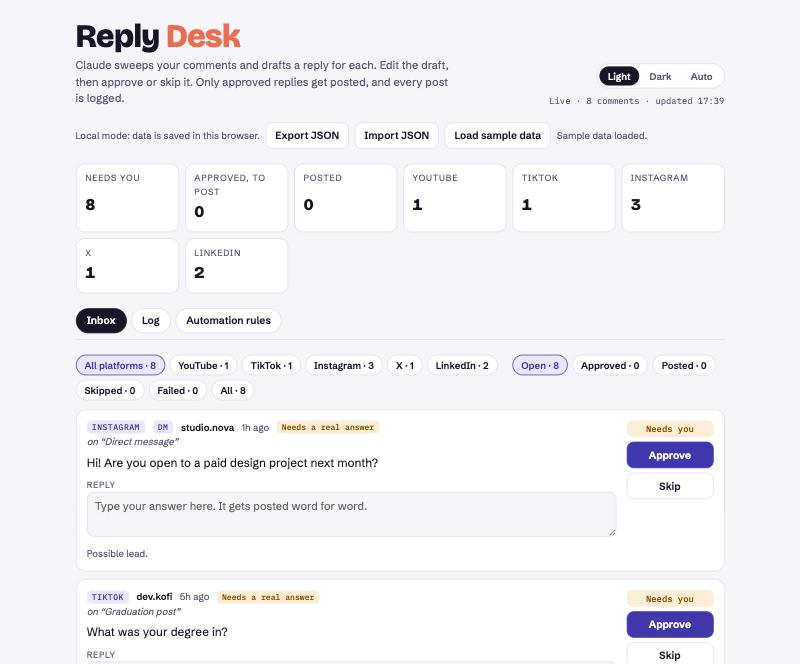

# Reply Desk

An approval-first social media reply desk, run by an AI agent.

Your agent sweeps your comments on YouTube, TikTok, Instagram, X, LinkedIn and Facebook, and drafts a reply in your voice for each one. You edit, approve or skip them on one page. Then the agent posts only what you approved, reads every reply back on the platform, and logs it.

Built by [Tassy Omah](https://www.instagram.com/tassy.omah/) with Claude.



## What's in here

| Path | What it is |
|---|---|
| [`PROMPT.md`](PROMPT.md) | The full prompt. Paste it into Claude (or any agent that can drive a browser) to build and run your own Reply Desk |
| [`app/reply-desk.html`](app/reply-desk.html) | The page itself, as a single HTML file |
| [`examples/sample-data.json`](examples/sample-data.json) | Fictional comments and rules to try it with |

## Try the page in 30 seconds

1. Download this repo, or clone it.
2. Serve the folder, so the sample loader can read the JSON:
   ```bash
   npx serve .
   ```
3. Open `http://localhost:3000/app/reply-desk.html` and click **Load sample data**.

Outside Claude, the page runs in local mode, which saves everything in your browser. Export JSON and Import JSON move your data around.

## Run it for real, with Claude

1. Open Claude Code or the Claude desktop app with **Claude in Chrome** connected, signed in to your social accounts in Chrome.
2. Paste [`PROMPT.md`](PROMPT.md) after filling in your handles.
3. Claude publishes the page as a private Artifact with a database. It sweeps your comments and sends you the link.
4. Approve replies on the page, then tell Claude "post".

## How it works

```
sweep comments ──► drafts land in Reply Desk ──► you approve / edit / skip
                                                        │
          log ◄── read each reply back ◄── post approved replies only
```

- **Nothing is posted without your tick.** The automation rules start switched off. You turn on one kind of reply at a time, once you trust it.
- **Your wording is posted exactly as you wrote it.** Every instruction you give is written to a dated log and checked before posting.
- **Every post is verified on the platform** before it's marked posted.

## License

MIT. Use it, fork it, make it better. A link back is appreciated.
